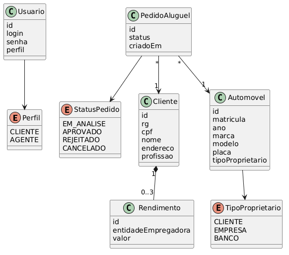
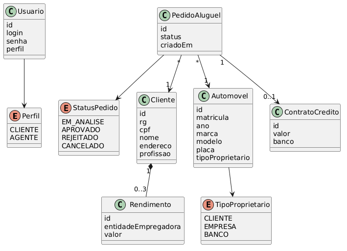
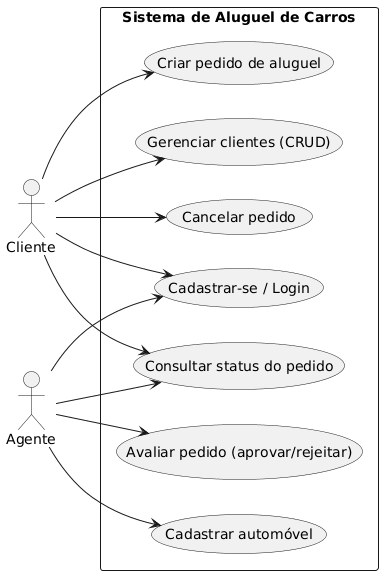
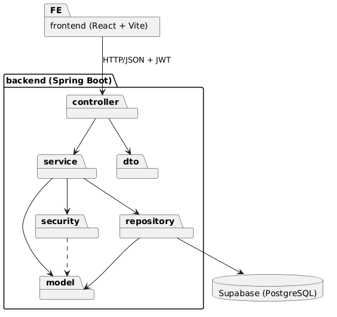
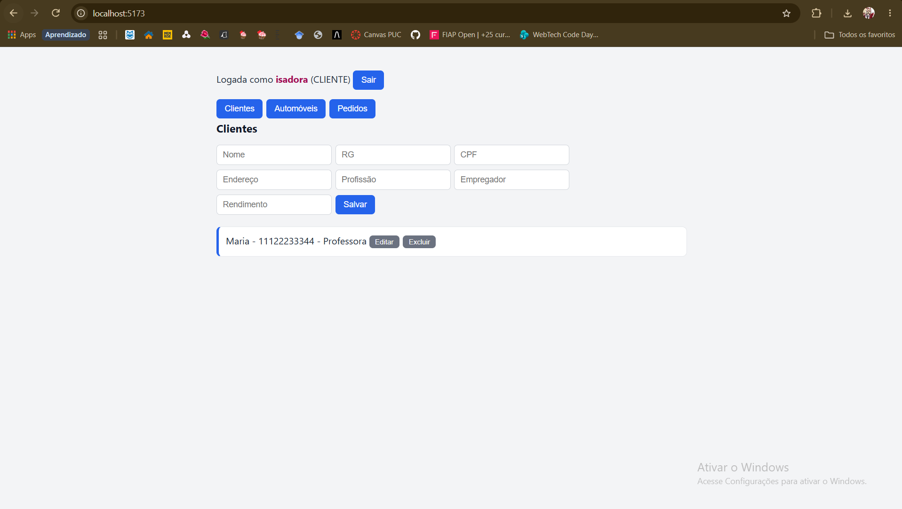
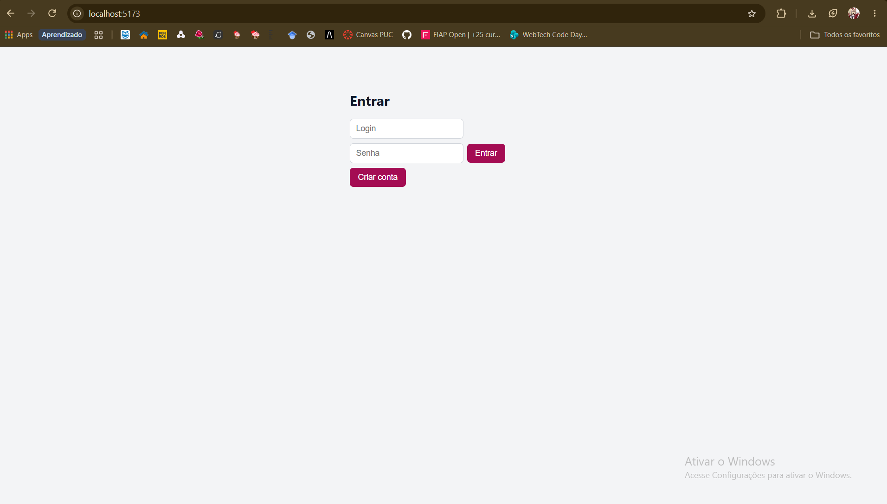

# alugueldecarros

# Sistema de Aluguel de Carros

Projeto da disciplina DIAW - PUC Minas (Laboratório 02).

## Tecnologias
Java 25, Spring Boot 4.0.x, Maven, React + Vite, Supabase (PostgreSQL), JWT.

## Arquitetura
MVC no back-end (controller, service, repository, model), front-end em React consumindo a API REST. Diagramas em `docs/`.

## Como rodar
Back-end (na raiz): defina `application-local.properties` com a URL, usuário e senha do Supabase e `jwt.secret`, e rode:
`.\mvnw spring-boot:run "-Dspring-boot.run.profiles=local"`

Front-end: `cd frontend`, `npm install`, `npm run dev` (http://localhost:5173).

## Funcionalidades
Login e cadastro, CRUD de clientes, cadastro de automóveis, criação e consulta de pedidos, avaliação de pedidos por agentes, contrato de crédito: agente registra valor e banco de um pedido.

## Diagramas e protótipo

## Limitações

- O contrato de crédito existe só na API (sem tela no front-end).
- Agentes (empresas e bancos) são representados apenas pelo perfil de login, sem entidade própria.
- O cadastro permite escolher o perfil AGENTE livremente; em produção isso seria restrito.
- O usuário ainda não está vinculado à entidade Cliente.
- O front-end edita um rendimento por cliente, embora o back-end aceite até 3.